# GDream

[](LICENSE)

> 本地运行的 AIGC 创作工作台：AI 对话、剧本拆解、画布、流水线工坊与剪辑。当前仍为 Tauri 桌面应用；Web 与多租户版本尚待实施。

GDream 基于 React + TypeScript、Tauri / Rust 和固定版本的 DeepSeek Harness。项目与媒体主要保存在本机，外部模型服务由用户自行配置。

**许可：本仓库新增及有权许可的内容仅限非商业用途，商业使用需另行授权。原有 MIT 代码和第三方许可保留，具体范围见 [LICENSING.md](LICENSING.md)。**

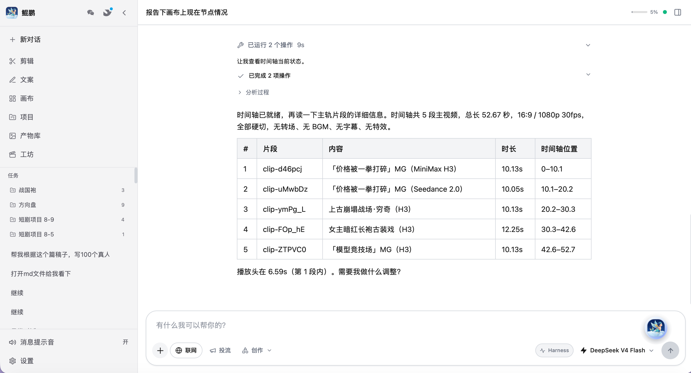

## 本地与自定义 API

除内置官方/中转渠道外，设置页现在支持接入本地或私有部署服务：

- **文本模型**：设置 → API 密钥 → 语言模型服务 →「自定义 OpenAI 兼容接口」；填写 `Base URL`、模型名和 Key，接口使用 `/chat/completions` 与 Bearer 认证。
- **图片模型**：设置 → API 密钥 → 图片 API → 添加「自定义 OpenAI 图片接口」；接口使用 `/v1/images/generations`，返回 `data[0].url` 或 `data[0].b64_json`。
- **视频模型**：设置 → API 密钥 → 视频与语音 → 视频引擎选择「自定义接口」，当前按 `vllm-omni serve` 的 `/v1/videos`、`/v1/videos/{id}`、`/v1/videos/{id}/content` 协议工作；创建请求使用 multipart 表单，支持文生视频和本地参考图/视频。
- 本地服务默认示例地址为 `http://127.0.0.1:8000`；视频服务不校验 Key 时可直接留空。

## 全链路功能

不是简单的一键生图、一键成片，而是从**剧本拆解 → 分镜预演 → 资产管理 → 提示词迭代 → 画面生成 → 后期剪辑**的全链路影视级工作台。所有项目、素材、成片、分镜、文案统一归档，一站式闭环。

### 普通对话：DeepSeek Harness + 国产大模型全家桶

- 对话编程（vibe coding）与 AI 内容创作两种日常模式，主界面参考 Codex 的交互逻辑。
- 所有助手入口统一使用固定版 **DeepSeek Harness**（ACP/MCP 桥），不提供旧内置模式切换或失败回放。
- 同时接入 **GLM-5.3 / Kimi K3 / MiniMax M3 / 通义 Qwen3.8 / 豆包 Seed 2.1**，按所配渠道协议接入，Agent 执行统一经过 DSH；失败明确报错，不重放已执行付费工具的任务。

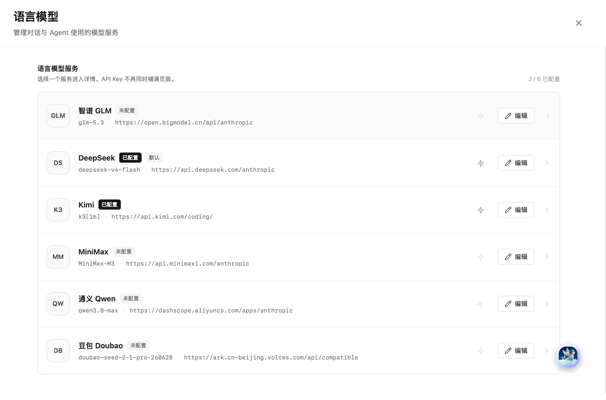


### 全能画布：主流画布能力全配齐

智能扩图、局部重绘、擦除物体、抠图去底、专业色卡、一键三视图、反推提示词，全部内置；画布支持全智能自动化操作——打开侧边 AI 助手，全程用自然语言指挥 AI 搭建画布、排布节点、优化画面结构。

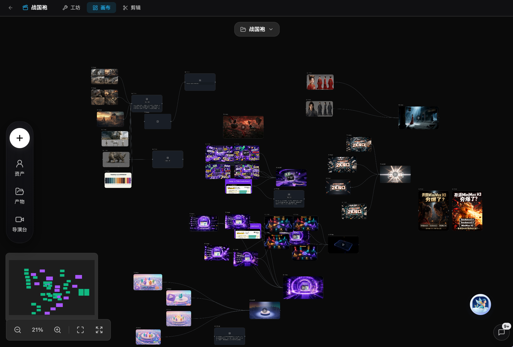

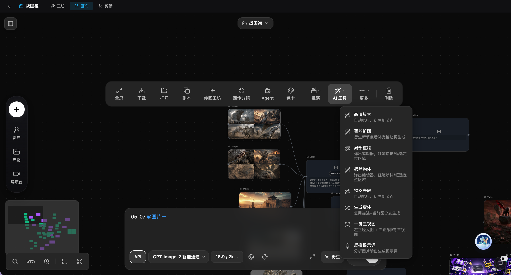

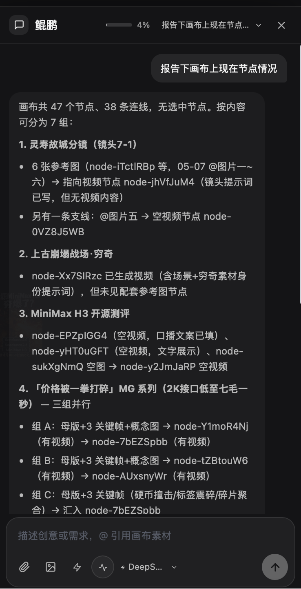

### 风格库：245 种一键风格

内置 **161 种 GPT 全系风格 + 84 种 Midjourney 专属风格**（附实测参数），自然语言描述即可一键匹配，免去手写复杂提示词的工作量。


### 流水线工坊：打磨最久、使用率最高的核心

传统画布的痛点是项目一多资产就乱、节点线路密密麻麻。工坊模式把整个生产过程结构化：

1. 上传一篇完整剧本，AI 自动拆解剧情、拆分镜头、生成角色/场景资产图、输出每镜专属视频提示词，全自动跑通生产流水线；
2. 所有素材、图片、视频、台词、提示词以结构化表格规整呈现，可单独提取、单独修改、单独迭代；
3. 模块双向互通：流水线资产一键导入画布精修，画布调整完又回流流水线继续批量出片。

小白可以一键全自动出片，老手把它当专属的分镜库、素材库、提示词仓库。

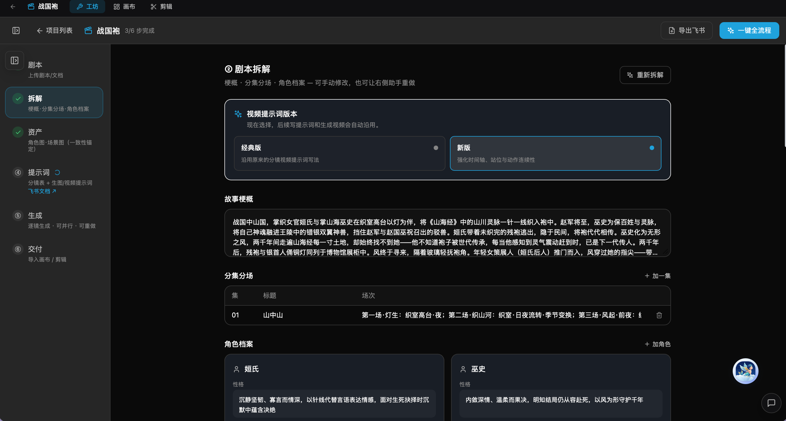

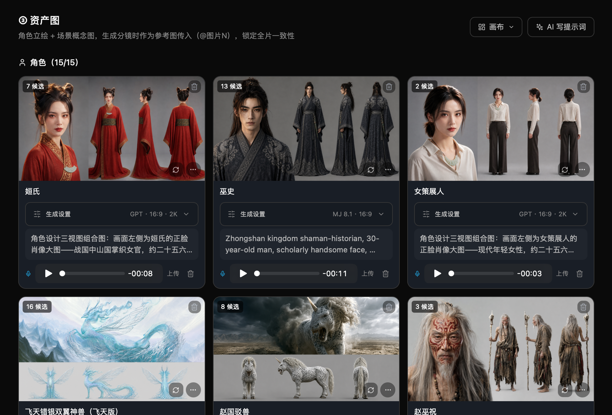

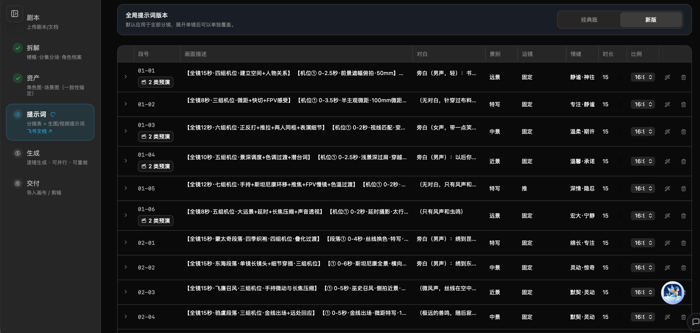

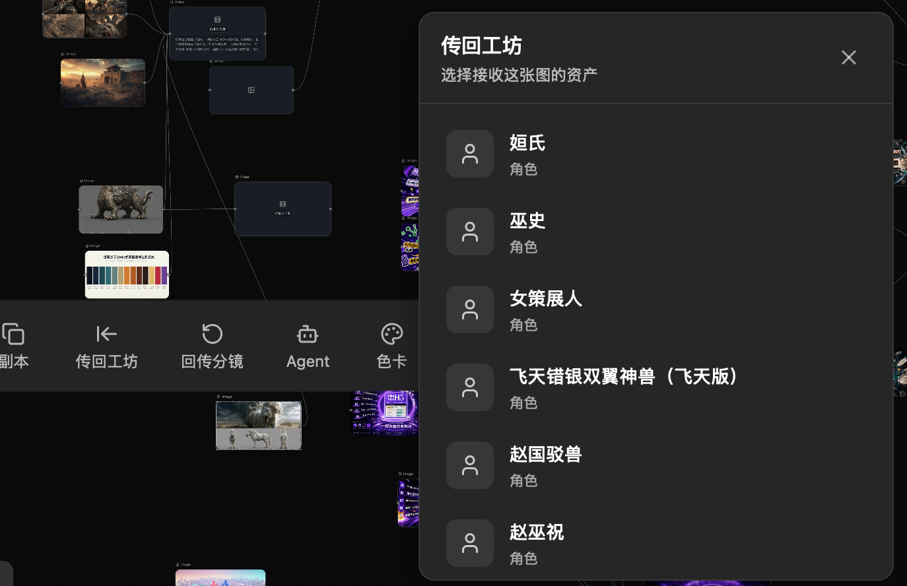

### 故事板与镜头规划

影视级项目工作台：自动读取剧本生成高清故事板（导演约束版、九宫格分镜版），镜头画面、表演细节、构图风格都可单独修改。另内置两套顶配提示词模板，分别适配 Seedance 2.0 / 2.5 的模型质感。

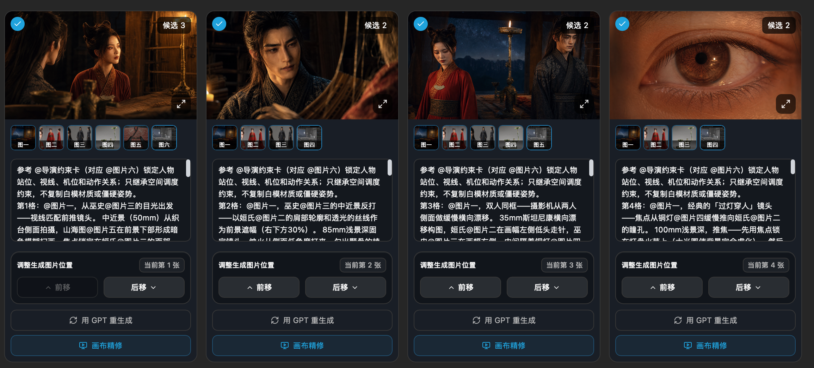

### 对话式 AI 剪辑（A 剪）与配音闭环

短视频口播或长篇剧情，都可以用对话指令完成剪辑：自动剔除口播水词、优化语句节奏。配音环节先用豆包精修配音，再导入工作流精准把控音画匹配。

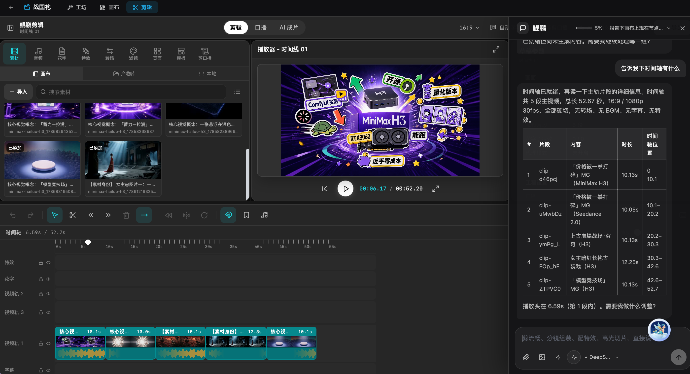

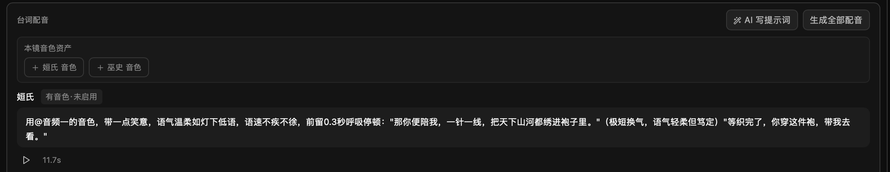

### MG 动画

HTML 页面动效 + MiniMax H3 / Seedance Mini / Omni 多引擎生成，画布内置 72 种 MG 风格预设，动画制作效率翻倍。

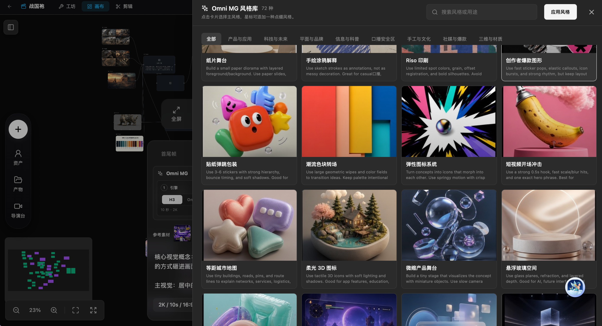

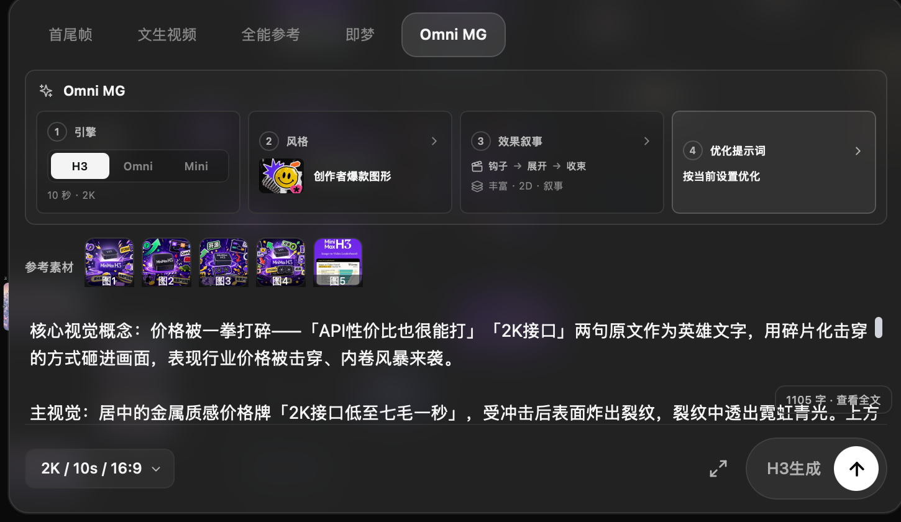

### AI 写作：去 AI 化审阅

内置自研的去 AI 化审阅模式，自动识别并优化 AI 写作的通病（生硬、模板化、空洞），配合按实战影视编剧规范打磨的编剧 Skill 系统。实话实说：AI 只能辅助规避问题，创意、审美、故事内核永远靠创作者自己——它能做的是洗掉文案的机器感。

### 开放

- **极强的 API 拓展性**：生图/生视频/语音多渠道自由接入替换，新模型上线可第一时间适配——这也是当初坚持自研的核心原因。
- **本地优先**：项目、素材、成片全部落在本机 `~/.gdream/`，不依赖任何第三方协作平台。

## 安装

### 下载安装包（macOS，Apple Silicon）

从 [Releases](../../releases) 页面下载最新的 `.dmg`，拖入「应用程序」即可。

> **未签名应用的 Gatekeeper 提示**：当前发布包未做 Apple 开发者签名，首次打开可能提示「无法打开，因为无法验证开发者」或「已损坏」。解决方法二选一：
>
> 1. 在 Finder 中**右键点击应用图标 → 打开**，在弹窗中再点「打开」；
> 2. 进入 **系统设置 → 隐私与安全性**，在底部找到GDream的拦截记录，点「**仍要打开**」。
>
> 如提示「已损坏，移到废纸篓」，可在终端执行 `xattr -cr /Applications/GDream.app` 后重试。

## 5 分钟上手

1. **获取 DeepSeek API Key**：前往 <https://platform.deepseek.com> 注册并创建 API Key。
2. **首次启动引导**：按引导填入 API Key 即可完成基础配置（每一步都可跳过，之后在设置里随时补配）。
3. **跑第一条任务**：在对话窗口输入一句需求，例如「帮我把这张参考图做成 15 秒的口播视频分镜」，观察 Agent 调用工具、产出结果的全过程。

## 配置

### 对话模型

| 渠道 | 说明 | 备注 |
| --- | --- | --- |
| DeepSeek | 默认推荐，走内嵌 DeepSeek Harness 引擎 | 需 API Key（platform.deepseek.com） |
| GLM（智谱） | GLM-5.3 / 5.2，Anthropic 兼容协议 | 需 API Key |
| Kimi（Moonshot） | K3 系列，原生视觉与 1M 长上下文 | 需 API Key |
| MiniMax | M3 / M2.7 / M2.5，1M 上下文 | 需 API Key |
| 通义 Qwen | qwen3.8-max 等，百炼 DashScope | 需 API Key |
| 豆包 Doubao | Seed 2.1 Pro，火山方舟 | 需 API Key |

### 图像 / 视频 / 语音生成渠道

| 渠道类型 | 说明 | 备注 |
| --- | --- | --- |
| 视频生成 | Seedance 2.0/2.5（筷子丽帧 / RunningHub / 火山方舟三通道可选）、MiniMax H3（RunningHub / APIMart 双渠道容灾）、Omni MG、即梦本地 CLI | 部分渠道**需自行配置密钥** |
| 图像生成 | Seedream 系、GPT-Image 系、Midjourney 系等 | 部分渠道**需自行配置密钥** |
| 语音 / ASR | 豆包语音（筷子丽帧 / 官方双通道） | 需自行配置密钥 |

#### 自定义 MiniMax-H3（SGLang）

工坊中的自定义 MiniMax-H3 默认使用 `http://127.0.0.1:7863`，协议为 `sglang-h3`，提交接口为 `POST /v1/videos`，任务查询接口为 `GET /v1/videos/{id}`。该服务运行 `fl2va` 分区，因此首尾帧/参考素材请求使用 `task: "fl2va"`，不要发送服务未提供的 `ref2va`。请求会把本地资产从原始保存位置读取并编码为 Data URI，不要求用户配置服务器文件映射；提示词中的 `@图片N`、`@音频N`、`@视频N` 会转换为 `<Picture N>`、`<Audio N>`、`<Video N>`。

H3 任务提交后每 `10` 秒查询一次，不设置固定生成超时；旧版 `30010` 和 `7861` 地址会在设置迁移时统一切换到 `7863`。提交前会校验至少存在一个参考素材，并阻断超出图片 `9`、音频 `3`、视频 `3` 的请求。任务会保存提交时实际使用的 Base URL，因此切换服务或重启应用不会把已提交任务错误恢复到新端点。可使用 `npm run test:minimax-h3` 回归端口迁移和请求契约。

设置页的“测试 H3 连接”只读取 `/health` 和 `/v1/models`，不会创建视频任务；生成页展开分镜详情后可点击“查看 H3 提交参数”，核对最终 `<Picture N>` / `<Audio N>` / `<Video N>` 提示词、条件顺序、首尾帧和上一镜尾帧。任务中断时从任务面板选择“恢复查询”，不会再次提交同一生成请求。

#### Story Director 原子镜头流程

工坊的剧本生产顺序为 `剧本 → Scene → Narrative Beat → Atomic Shot → 连续性 → 提示词 → 生成 → 评审 → 交付`。每个 Atomic Shot 默认按约 5 秒规划，只允许一个地点、连续时间、一个主要动作目标、一次核心状态变化、一个主要机位和一种主要运镜；同场承接镜头自动把上一镜 `exitState` 作为下一镜 `entryState`。拆解页的“导演结构报告”会展示 Hook、信息递进、升级、镜头密度和声音意图证据；它用于提示创作者复核，不会替代创作者的审美判断或自动重写剧情。

#### 首尾帧与成片多模态质量门禁

工坊生成链路支持 `首尾帧 → 图片审核 → 视频生成 → 视频终审 → 人工采用 → 交付` 的完整门禁。默认审核服务为 `http://127.0.0.1:30377`，模型为 `qwen3.8-27b`，使用 OpenAI 兼容的 `/v1/chat/completions` 多模态协议。密钥只在“设置 → API 凭证”中保存，再由“设置 → 集成服务 → 多模态质量审核”引用，不会写入普通配置、日志或导出文件。

- 首尾帧会检查人物身份与尺度、相对位置、场景拓扑、道具状态、光影、构图、动作起止状态和画面合规性。
- 审核失败时只按结构化缺陷追加最小提示词补丁；默认优先重绘尾帧，明确指出首帧问题时才连同首帧重绘，最多三次。
- 三次仍未通过会标记为需要人工复盘，并禁止提交视频；审核服务不可用时同样失败关闭，不会把未审核帧当作通过。
- 视频生成完成后会保存候选，再执行动作、连续性、角色稳定性、声画同步和画面质量终审；未通过候选无法采用或交付，但文件不会丢失。
- 项目会沉淀高分提示词与高频问题规避规则。后续提示词生成只复用结构、细节密度和规避规则，不复制其他镜头的剧情内容。

设置页的“检查连接”只调用 `/v1/models`，不会提交生图或视频任务。生产审计和交付清单会记录审核状态；交付清单 schema v3 还会写入终审分数、模型和审核时间。

> **第三方渠道声明**：第三方渠道为用户自配，本项目不担保其可用性与价格；所有内置渠道列表仅为开发时的接入选项，**不构成任何商业推荐**。你可以自由修改源码接入、替换或移除任何兼容的 API 服务。

## 适合谁 / 不适合谁

**适合**：有一定基础的创作者、开发者、工作室——可以把模块嵌入自己的 Agent、改造自有工作流、自主新增 API 接口；能接受自主微调、自行修复小 BUG、想深耕 AIGC 工作流的人。

**不适合**：完全不懂编码、不了解 Codex、没有基础 AI 工作流认知、只想零折腾上手即用的用户——市面商业成品工具有专业团队持续运维，会是更好的选择。

## 已知边界（实话实说）

- **目前只有 macOS 版本**（Apple Silicon 为主）。Windows 移植难度较高暂未实现，欢迎有兴趣的开发者一起共建。
- 当前仍有桌面文件路径、前端状态与任务编排的耦合；迁移 Web 时需拆分数据持久化和服务端执行职责。
- 内置 AI 精细剪辑能力仍有局限，高精度成片可能需要外接专业剪辑软件处理；商业使用仍受许可约束。
- 团队核心重心是自有内容创作，很难逐一响应外部 BUG 反馈和新增需求；Issue 会尽力回应，更欢迎 PR 共建。

## 从源码构建

环境要求：Node.js 24+、Rust 工具链（rustup）、macOS。

```bash
# 安装依赖
npm install
npm ci --prefix dsh-runtime
npm run setup:dsh-node   # 下载内嵌 Node 运行时（gitignored，首次构建需要）

# 开发模式（热更新）
npm run tauri:dev

# 打包（公共构建为纯净版，不含任何私人资源）
npm run tauri:build
```

常用测试：`npm run test:harness`、`npm run test:dsh-runtime`、`npm run test:omni`、`npm run test:context`；Rust 侧：`cargo check --manifest-path src-tauri/Cargo.toml`。

## 架构简图

```text
你的电脑内
  React 界面：对话 / 工坊 / 画布 / 剪辑
      ↓
  TypeScript 业务与 Store：准备输入、生成编排、任务状态、结果绑定
      ↓
  Tauri / Rust：文件读写、HTTP / 系统能力、DSH 进程管理
      ├─ 本地 JSON / 图片 / 视频
      ├─ 外部图片 / 视频 / 音频服务
      └─ DSH Node 进程 → 外部语言模型
               └─ 工具请求经桥返回前端工具与业务逻辑执行
```

部分轮询和全流程推进仍依赖客户端运行。外部 Provider 的生成可能在客户端退出后继续，但客户端查询、下载、登记结果和续跑不等于独立服务端任务。

## 源码与许可

源码用于许可允许的非商业学习、研究和改造。商业使用需取得相应权利人的明确授权；许可范围、历史 MIT 代码和第三方组件例外以 LICENSING.md 为准。

## 参与贡献

欢迎 Issue 和 PR！请先阅读 [CONTRIBUTING.md](CONTRIBUTING.md)。行为准则见 [CODE_OF_CONDUCT.md](CODE_OF_CONDUCT.md)，安全问题报告见 [SECURITY.md](SECURITY.md)。

## 第三方声明与 License

- 本仓库新增及有权许可的内容以 [PolyForm Noncommercial 1.0.0](LICENSE) 提供，仅限许可允许的非商业用途；原有 MIT 及第三方许可范围见 [LICENSING.md](LICENSING.md)。
- 第三方组件声明见 [THIRD-PARTY-NOTICES.md](THIRD-PARTY-NOTICES.md)（含 DeepSeek Harness、Node.js、sharp/libvips 等）。
- 更新记录见 [CHANGELOG.md](CHANGELOG.md)。

### 设置持久化与启动保护

- `~/.gdream/settings.json` 是设置的持久化来源；开发版与安装版启动时都先读取文件，只有文件不存在才从各自 WebView 缓存迁移。
- 设置恢复完成前不挂载主界面、不应用私有默认值；文件损坏或不可读时显示重试提示，不拿空配置覆盖。
- 设置通过 `write_text_file_private` 的校验模式写入：实例间文件锁、原始内容比较、0600 临时文件和原子替换。另一实例修改配置后，旧实例停止保存并显示提示，应关闭其他实例并重启再配置。旧版本不具备此保护，不应与新版并行运行。
- 凭证删除是明确保存的操作；重新启动不会从旧缓存恢复已删除的凭证。
- 回归：`npm run test:settings-persistence`；后端锁与原子写入：`cargo test --manifest-path src-tauri/Cargo.toml settings_storage`。

#### 工坊状态读取参数契约

`workshop_get_state` 在共享工具入口规范化可选读取字段的空字符串、空白与 null，不修改调用记录。空 `output_id` 搭配省略/null/数值 0 的 offset 表示首次读取；非空快照编号始终按续页处理，必须带有效整数偏移，不能静默降级为第一页。不会把字符串数字转换成游标，也不会全局清理写入工具的空值（空值可能表示明确删除）。DSH 通过共享工具入口使用同一实现。

`npm run test:state-paging` 重放真实 DSH 空默认值参数，通过注册工具与 DSH 桥读取全部分页，并验证非法游标和跨项目访问被拒绝；不联网、不生成付费素材。

### DSH 唯一执行引擎

所有助手入口统一通过 DSH 执行，保留渠道/模型选择，不提供普通模式开关或失败回退。协议、凭证或模型配置缺失会明确阻断；运行错误不会重放任务。设置 v45 删除旧 deepseekEngine 配置。输入栏显示非交互式 DSH 状态。AgentCoordinator 暂保留用于上下文构建、历史与工具注册，不再承接用户任务的旧执行循环。
