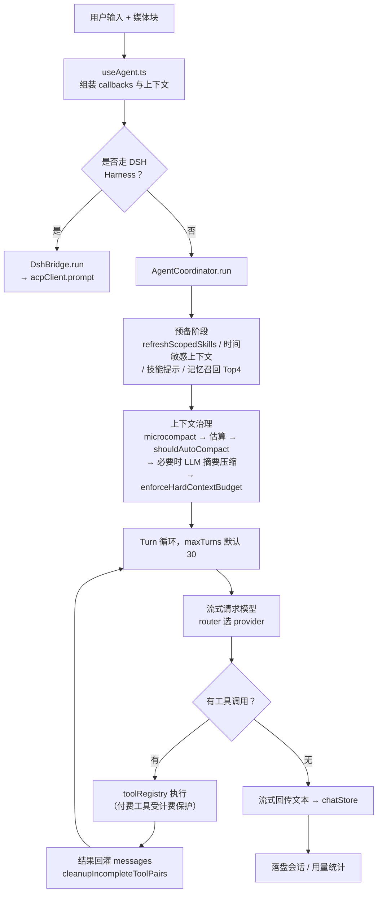
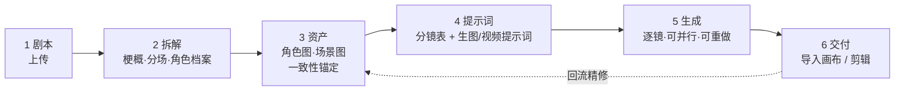
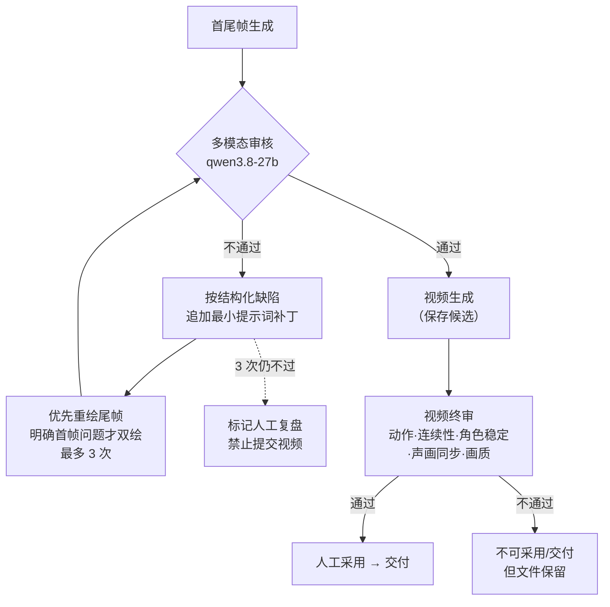

# GDream — 架构与功能流程总览

> 历史结构快照：v2.9.8；部分功能、规模与调用方式已变化，不能作为当前验收结论。
> 当前许可范围见 [LICENSING.md](../LICENSING.md)，旧模块移除范围与验证见 [残留审计](legacy-code-audit-2026-11-17.md)。
> 代码规模约 17 万行（`src` + `src-tauri/src` 的 ts/tsx/rs）
> 本文是代码结构勘察结论，所有结论均可按文件路径回溯验证。

---

## 一、项目定位

Tauri 1.x + React 18 + Rust 的 **macOS 桌面 AIGC 视频创作工作台**。最初是团队自用的内部工具，多条百万赞、十多条十万赞 AI 短片均由它产出，经商用项目打磨后开源。

核心主张：**不是一键生图/一键成片，而是全链路影视级工作台** ——
`剧本拆解 → 分镜预演 → 资产管理 → 提示词迭代 → 画面生成 → 后期剪辑`，项目与素材统一归档。

---

## 二、分层架构

```
┌─────────────────── 前端 UI（React 18 + zustand）───────────────────┐
│  chat │ canvas │ workshop │ editor │ copywriting │ director        │
│                    src/components/*                                 │
└───────────────────────────────┬────────────────────────────────────┘
                                │ hooks/useAgent.ts（2008 行，对话入口）
┌───────────────────────────────▼────────────────────────────────────┐
│  Agent 编排层                                                       │
│  lib/agent/coordinator.ts  AgentCoordinator（58KB，核心状态机）      │
│  ├── contextManager / autoCompact / contextRetention（上下文治理）   │
│  ├── toolRegistry（约 40 个工具，按域分组注册）                       │
│  └── providers/router.ts（模型路由与降级）                            │
└──────────┬──────────────────────────────────┬──────────────────────┘
           │ 自研 agent loop                   │ DSH 桥
           ▼                                   ▼
┌────────────────────────┐        ┌──────────────────────────────────┐
│ GLM / Kimi / MiniMax   │        │ lib/agent/dsh/DshBridge.ts       │
│ Qwen / 豆包             │        │  → acpClient（ACP 协议）          │
│ providers/*（Anthropic │        │  → toolBridge/toolRpc（TCP 工具桥）│
│  兼容协议）             │        │  → dsh-runtime/（独立 Node 进程）  │
└────────────────────────┘        └──────────────────────────────────┘
           │                                   │
           └───────────────┬───────────────────┘
┌──────────────────────────▼─────────────────────────────────────────┐
│  供应商适配层  lib/imageGen · videoRouter · omni · kuaizi ·        │
│  midjourney · suno · rhtv · doubaoSpeech · doubaoAsr · dreamina ·  │
│  seedance / seedance25 · canvasGen                                 │
└──────────────────────────┬─────────────────────────────────────────┘
                           │ Tauri IPC（约 70 条命令）
┌──────────────────────────▼─────────────────────────────────────────┐
│  Rust 底座 src-tauri/src                                           │
│  wechat(12) commands(10) browser(6) dsh(5) mcp_stdio(4)              │
│  main(4) project_archive(2) stream_proxy(2) kimi(1) tools/         │
└────────────────────────────────────────────────────────────────────┘
```

### 每层职责

| 层 | 目录 | 职责 | 备注 |
|---|---|---|---|
| UI | `src/components/` | 五大域 + 远程/设置/引导 | 组件按域分包，`index.ts` 汇总 |
| 状态 | `src/stores/` | zustand，约 24 个 store | `stores/index.ts` 只导出 11 个，其余按域单独 import |
| 编排 | `src/hooks/` + `src/lib/agent/` | 对话编排、模型路由、工具执行 | 最重的一层 |
| 引擎 | `lib/agent/providers/` + `lib/agent/dsh/` | 自研 loop 与 DSH 双轨 | 见 §4.2 |
| 适配 | `src/lib/<vendor>/` | 各家 AIGC API 封装 | 与业务解耦，新增渠道只加目录 |
| 业务 | `lib/workshop` `lib/canvas` `lib/editor` `lib/copywriting` `lib/production` | 功能域纯逻辑 | 大多可独立测试 |
| 底座 | `src-tauri/src/` | 文件/进程/协议/系统集成 | 71 条 IPC |

---

## 三、目录地图（关键单点）

### 3.1 `src/lib/agent/` — Agent 体系

| 文件/目录 | 作用 |
|---|---|
| `coordinator.ts` | `AgentCoordinator`，唯一的对话状态机，`run()` 从 471 行到 1038 行 |
| `providers/router.ts` | 模型路由：`primary` / `fallback_chain` / `parallel_race` / `task_routing` |
| `providers/registry.ts` | provider 实例注册与查找 |
| `glmClient.ts` / `kimiClient.ts` | 早期单供应商客户端（glm 仍被 `coordinator` 直连使用） |
| `contextManager.ts` | 上下文估算、`microcompact`、LLM 摘要压缩（28KB） |
| `autoCompact.ts` | `shouldAutoCompact(estimated, modelId)` 决策 |
| `contextRetention.ts` / `contextCompaction.ts` | 保留策略与压缩实现 |
| `completionGuard.ts` | 完成度守卫（防止模型提前收尾） |
| `toolRegistry.ts` | `createDefaultRegistry()`，约 40 个工具，分 10 组注册 |
| `tools/` | 工具实现，按域分文件（见 3.2） |
| `dsh/` | DeepSeek Harness 桥（见 3.3） |
| `skillLoader.ts` | 技能加载（63KB 巨型文件，技术债） |
| `systemPrompt.ts` / `skillPromptPolicy.ts` | 系统提示词组装与技能注入策略 |
| `evolution.ts` / `evolutionCursor.ts` / `autoDream.ts` | 自我演进/记忆迭代机制 |

### 3.2 工具分组（`tools/`，注册入口 `toolRegistry.ts:170`）

| 分组 | 文件 | 内容 |
|---|---|---|
| 基础 | `bashTool` `readTool` `writeTool` `editTool` `globTool` `grepTool` `listDirectoryTool` | 文件与命令 |
| 网络/交互 | `webFetchTool` `webSearchTool` `browserTool` `askUserQuestionTool` `sleepTool` `memoryTool` `scheduleCronTool` `taskStatusTool` | 外部世界与用户交互 |
| 生成 | `imageGenerateTool` `videoGenerateTool` `genTools` `canvasGenerateTool` `doubaoSpeechTool` | 付费工具，受计费保护 |
| 画布 | `canvasTools`(15) `canvasTranscribeTool` | 节点操作 |
| 工坊 | `workshopTools`(35) | 流水线操作，最大一组 |
| 分镜 | `storyboardTools`(9) | 高清故事板与导演约束参考 |
| 剪辑/文案 | `timelineTools` `copywritingTools`(7) | A 剪与去 AI 化 |
| 其它 | `projectTools` `skillInvokeTool` `apimartRouteTool` | 项目、技能 |

### 3.3 `src/lib/agent/dsh/` — DeepSeek Harness 桥

| 文件 | 作用 |
|---|---|
| `DshBridge.ts` | `run(options)` 对外唯一入口，内含 guidance 补投逻辑 |
| `acpClient.ts` | ACP 协议客户端（与独立 Node 进程通信） |
| `toolBridge.ts` / `toolRpc.ts` | TCP 工具桥：Harness 反过来调主进程工具 |
| `routing.ts` | 什么时候走 Harness、什么时候降级 |
| `mediaFilter.ts` | 媒体块过滤（避免超限） |

### 3.4 `dsh-runtime/` — vendored 运行时

`dsh-runtime/` 是 **DeepSeek Harness 官方运行时的 vendored 副本**（`DSH_RUNTIME_REVISION = 0.1.0-rc.6-gdream.7`），自带 Node 二进制与 `@deepseek-ai/*` 包。

- `gdream-acp-host.mjs` — ACP host，挂载 spine / compaction / tokenMeter / JSONL+SQLite 持久化；通过 stderr `__GDREAM_DSH_EVENT__` 向外抛 `reasoning` / `usage` / `tool_call` / `compaction` 事件。
- `gdream-mcp-server.mjs` — MCP stdio server，凭 `GDREAM_TOOL_BRIDGE_ADDR/TOKEN` 经 TCP 回连主进程实现工具双向调用。
- 启动方：Rust `dsh.rs:500 ensure_runtime` 部署运行时 → spawn 自带 node → 绑定 TCP bridge。`dsh.rs:182` 负责定位 `dsh-runtime/`。

### 3.5 `src/lib/workshop/` — 工坊（业务最重）

| 文件 | 作用 |
|---|---|
| `types.ts` | `WORKSHOP_STEPS`、`WorkshopData`、`AssetCandidate`、`AssetReviewReceipt` |
| `breakdownSchema.ts` / `breakdownValidation.ts` | 拆解结果结构校验 |
| `shotPlanning.ts` / `shotContinuity.ts` / `shotMutation.ts` / `shotRefs.ts` | 镜头规划、连续性、引用绑定 |
| `characterContinuity.ts` / `episodeContinuity.ts` | 角色与分集一致性 |
| `storyboardBridge.ts` | 故事板桥接 |
| `qualityReview*.ts` / `qualityLearning.ts` / `qualityStats.ts` | 多模态质量门禁与学习 |
| `productionAudit.ts` / `productionPacket.ts` / `productionLifecycle.ts` | 生产审计、提交包、生命周期 |
| `deliveryManifest.ts` | 交付清单（schema v3） |
| `narrativeGuard.ts` | 叙事守卫 |
| `directorReport.ts` / `storyDirectorPrompt.ts` | 导演结构报告与提示词 |
| `h3PromptContract.ts` | MiniMax-H3 提示词契约（`@图片N` → `<Picture N>`） |
| `providerCapabilities.ts` | 供应商能力校验（提交前拦截） |
| `legacyMigration.ts` | 老项目数据迁移 |

### 3.6 状态与组件

**store 分组**：`chat` `settings` `skill` `wizard` `backgroundTask` `memory` `aigcProject` `runStep` `deepseekHarness` `renderQueue` 由 `stores/index.ts` 统一导出；`canvas` `canvasTask` `workshop` `editor` `copywriting` `project` `unifiedProject` `director` `todo` `askUser` `toolConfirm` `wechat` `cron` `assetLibrary` 按域单独 import。

**组件域**：`chat` `canvas` `workshop` `editor` `copywriting` `director`（五大功能 + 导演），加 `shared` `wechat` `memory` `skills` `library` `settings` `wizard` `messaging` `projects`。

---

## 四、核心流程

### 4.1 一次对话请求的完整链路



**关键机制**（`coordinator.ts`）：

| 机制 | 位置 | 说明 |
|---|---|---|
| 会话修订号 | `run()` 入口 `historyRevision += 1` | 防止异步恢复结果覆盖实时历史 |
| 时间敏感上下文 | `isTimeSensitiveQuery` → `buildTemporalTurnContext` | 只在本轮注入，不落历史 |
| 记忆召回 | `findRelevantMemories` + `loadMemoryBodies` | 关键词打分取 3–4 条，作为 transient 附加 |
| 微压缩 | `contextManager.microcompact` | 静默清理可复现的工具输出与旧媒体 |
| 自动压缩 | `shouldAutoCompact` | 只有真要跑 LLM 摘要时才提示"整理上下文" |
| 硬预算 | `enforceHardContextBudget` | 兜底截断 |
| 转向干预 | `queueGuidance` / `flushPendingGuidance` | 用户可在运行中插话改向 |
| 工具配对修复 | `cleanupIncompleteToolPairs` / `repairToolPairingSnapshot` | 保证消息序列对 API 合法 |
| 失控刹车 | 重复工坊调用→终止、工坊写失败→终止、token 续写上上限 | 见下 |
| 工坊重写专用预算 | `rewriteTurnBudget = clamp(12 + 镜头数×4, 16, 96)` | 从通用 30 轮解耦，按镜头数伸缩 |

### 4.2 双引擎与降级纪律

- **自研 loop**：无 `routeStrategy` 时直连 `glmClient.streamChat`；有策略则走 `providers/router.ts`。
- **DSH 引擎**：DeepSeek 走内嵌 Harness，`DshBridge` → ACP → 独立 Node 进程，工具调用经 TCP 桥回主进程。
- **降级红线**（`AGENTS.md` + `harnessPolicy`）：DSH 是唯一执行引擎；失败明确报错，不回退旧引擎或重放任务。
- **未实现**：`router.ts` 的 `parallel_race` 与 `task_routing` 仍 `throw not implemented`（脚手架）。

### 4.3 工坊六步生产流水线

状态定义在 `workshop/types.ts:17`，`StepStatus = pending | in-progress | done | stale`（**stale = 上游改过，需重做**）。



**内部生产顺序（比 UI 六步更细）**：
`剧本 → Scene → Narrative Beat → Atomic Shot → 连续性 → 提示词 → 生成 → 评审 → 交付`

每个 Atomic Shot 默认约 5 秒，硬约束：一个地点、连续时间、一个主动作目标、一次核心状态变化、一个主景别、一种主运镜。同场承接镜头自动把上一镜 `exitState` 作为下一镜 `entryState`（`shotContinuity.ts`）。

**持久化**：`workshopStore.ts:129` → `~/.gdream/aigc-memory/projects/<id>/workshop.json`，经 `projectStore` 原子写。**文件是 source of truth**，zustand 只是内存镜像。

**资产模型**（`types.ts`）：
- `AssetCandidate` —— 生成/上传/产物库/画布回流都 **append，永不删除**；带 `checksum`、`inputFingerprint`、`productionPacket` 等冻结信息。
- `AssetReviewReceipt` —— 只有 `accepted` **且指纹仍匹配**时，候选才能作为正式生产资产。

### 4.4 生成与质量门禁



- 审核服务默认 `http://127.0.0.1:30377`，模型 `qwen3.8-27b`，走 OpenAI 兼容 `/v1/chat/completions` 多模态协议。
- **失败关闭原则**：审核服务不可用时视为不通过，不会把未审核帧当作通过。
- 审核密钥只在「设置 → API 凭证」保存，由「设置 → 集成服务 → 多模态质量审核」引用，**不写普通配置/日志/导出**。
- 终审分数、模型、审核时间会写入交付清单 schema v3。

### 4.5 画布生成任务生命周期（`lib/canvasGen/`）

| 文件 | 职责 |
|---|---|
| `index.ts` | 任务调度入口 |
| `taskPersistence.ts` | 任务持久化（支撑重启恢复） |
| `recoveryPolicy.ts` | 中断恢复策略 —— **只恢复查询，不重复提交** |
| `retryPolicy.ts` | 重试策略 |
| `taskMetrics.ts` | 任务指标 |
| `sglangH3.ts` | 自定义 MiniMax-H3（SGLang）提交实现 |

H3 契约要点：默认 `http://127.0.0.1:7863`，协议 `sglang-h3`，`POST /v1/videos` 提交、`GET /v1/videos/{id}` 查询；运行 `fl2va` 分区故首尾帧请求用 `task: "fl2va"`，**不要发 `ref2va`**；每 10 秒轮询、不设固定超时；提交前校验至少一个参考素材，并阻断图片 >9 / 音频 >3 / 视频 >3；任务保存提交时实际 Base URL，切换服务或重启不会错误恢复到新端点。

### 4.6 远程操控（微信）

Rust 侧 `wechat.rs`(66KB/12 命令) 提供微信消息通道；前端 `lib/messaging/` 提供三层保障：`remoteRun.ts`（远程执行）、`circuitBreaker.ts`（断路器）、`dedup.ts`（去重，防重复扣费）。

> 飞书（lark）集成已整体移除：UI 入口、`lark.rs`（15 命令）、`workshop_render_export` / `workshop_mark_exported` 工具、`exportTemplates` 渲染器、`lark-cli` 技能包与 `bitable` 数据模型均已删除。

---

## 五、单一事实源（改东西先找这里）

| 内容 | 文件 |
|---|---|
| 渠道清单 | `src/lib/channels/catalog.ts` — `CHANNEL_CATALOG`（chat/image/video/storage 四类） |
| Ark 模型注册表 | `src/lib/channels/arkModels.ts` — `ARK_MODELS`（id/label/modality/tier/status） |
| 凭证注册表 | `src/lib/credentials.ts` — `Credential` + `LEGACY_CAPABILITIES` + `resolve*()` |
| 模型目录 | `src/lib/agent/modelCatalog.ts` |
| 工具注册 | `src/lib/agent/toolRegistry.ts` |
| 工坊步骤 | `src/lib/workshop/types.ts:22` |
| 会话落盘 | `src/lib/historyPersistence.ts` / `projectSessions.ts` |
| 工坊产物 | `~/.gdream/aigc-memory/projects/<id>/workshop.json` |
| 内置知识库 | `aigc-memory/`（checklists / prompt-templates / reference / style-library） |
| 技能 | `skills/`（22 个：film-master、storyboard-sketch、script-doctor、omni-mg-animation 等） |

---

## 六、安全与计费纪律

1. **密钥**：只存 `settingsStore`（凭证注册表），不进日志/错误消息/进程参数/对话历史；写盘走 Rust `write_file_private`（0600）；设置导出不含凭证。
2. **付费工具禁止整轮重放**：生图/视频/配音一旦执行过，重试不能重跑整轮，避免重复扣费（`lib/billingSafety.ts`）。
3. **Harness 版本锁**：`0.1.0-rc.6`，不改 `dsh-runtime/node_modules`，升级需全量回归。
4. **gitignored 私人内容**：`private.defaults.json`、`AGENT.md`、个人技能与记忆目录 —— 不要把路径写进公开配置。

---

## 七、扩展点

| 想做什么 | 改哪里 |
|---|---|
| 新增对话模型渠道 | `channels/catalog.ts` + `credentials.ts` + `agent/providers/` 加实现 |
| 新增生图/生视频渠道 | `src/lib/<vendor>/` 新建目录 + `channels/catalog.ts` 登记 + Rust 侧如需代理 |
| 新增 Agent 工具 | `agent/tools/` 加文件 → `toolRegistry.ts:170` 注册 |
| 新增技能 | `skills/<name>/SKILL.md` + `skills-lock.json` |
| 新增长期知识 | `aigc-memory/` 对应子目录 |

---

## 八、技术债与已知边界

| 项 | 位置 | 性质 |
|---|---|---|
| 图片路由缺失 | `lib/imageRouter/` 只有 `metrics.ts` | 路由逻辑散落别处，应归位 |
| 路由策略未实现 | `providers/router.ts:116,296` | `parallel_race` / `task_routing` 抛 not implemented |
| 巨型文件 | `lib/agent/skillLoader.ts`（63KB）、`coordinator.ts`（58KB） | 建议按职责拆分 |
| 已废弃代码 | `lib/promptBuilder.ts:20` | 标 Deprecated，仅保编译 |
| 占位内容 | `SECURITY.md:11` 安全邮箱 | 开源发布前应补 |
| 未接监听 | `catalog.ts:20` 提到 `StatusBar.tsx` 监听器 | Tier 4.x 未完成 |
| 平台 | 仅 macOS（Apple Silicon 为主） | Windows 未移植 |
| 产品边界 | 内置 AI 精细剪辑仍有局限 | 高精度成片建议外接专业剪辑 |

---

## 九、命令速查

```bash
# 依赖
npm install
npm ci --prefix dsh-runtime
npm run setup:dsh-node          # 下载内嵌 Node（gitignored，首次构建必需）

# 开发 / 构建
npm run tauri:dev               # 热更新
npm run tauri:build             # 打包（无 private.defaults.json 时为纯净公开构建）
npx tsc --noEmit                # 类型检查

# 测试（按域分组）
npm run test:harness            # agent / DSH / 凭证 / 渠道（20 个测试文件）
npm run test:dsh-runtime        # Harness 运行时生命周期
npm run test:omni               # MG 动画风格
npm run test:quality-review     # 质量门禁与交付清单
npm run test:minimax-h3         # H3 端口迁移与请求契约
npm run test:canvas-persistence # 画布任务持久化
npm run test:context            # 上下文压缩与保留
npm run test:video-prompt       # 视频提示词
npm run test:midjourney         # MJ 提示词

# Rust
cargo check --manifest-path src-tauri/Cargo.toml
```

---

## 十、一句话总结

**这是一个把"影视工业化流程"映射成软件结构的项目**：上游用 Agent 把自然语言剧本结构化成分镜数据模型（Atomic Shot + 连续性状态机），中游用质量门禁把不确定的生成模型包进可审计的生产流水线（失败关闭、三次不过转人工），下游用画布/剪辑做精修回流。工程整洁度让位于产品深度 —— 这是它同时具备"很能打"和"有点乱"两个特征的原因。
