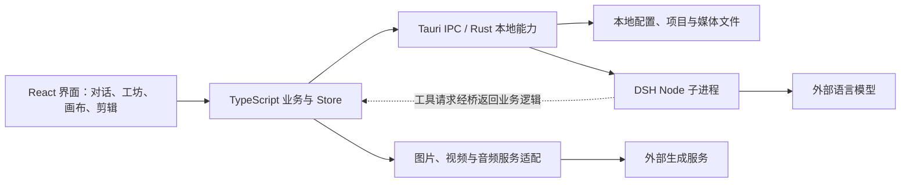

# 当前架构

[返回项目首页](../README.md) · [使用指南](usage.md) · [开发指南](development.md)

## 应用整体结构

GDream 当前是本地桌面应用：React 界面和 TypeScript 业务逻辑运行在 Tauri WebView 中，Rust 提供本地能力并管理 DSH 子进程。外部模型服务由用户配置。

生成服务的具体适配可使用前端请求或 Rust 提供的网络与文件能力。上图表示职责关系，不代表所有请求都沿同一条网络路径执行。

## 目录与职责

| 位置 | 职责 |
| --- | --- |
| [`src/components/`](../src/components/) | 对话、画布、工坊、剪辑等界面 |
| [`src/stores/`](../src/stores/) | 当前项目、设置、任务与界面状态 |
| [`src/lib/workshop/`](../src/lib/workshop/) | 剧本、分镜、资产、生成与审核相关逻辑 |
| [`src/lib/agent/`](../src/lib/agent/) | 上下文、历史、工具注册与 DSH 桥接 |
| [`src/lib/agent/dsh/`](../src/lib/agent/dsh/) | ACP 客户端、任务执行桥与工具往返 |
| [`src/lib/channels/`](../src/lib/channels/) | 渠道清单与模型注册 |
| [`src/lib/credentials.ts`](../src/lib/credentials.ts) | 凭证注册表 |
| [`src-tauri/src/`](../src-tauri/src/) | 文件、网络、系统能力与进程管理 |
| [`dsh-runtime/`](../dsh-runtime/) | 固定版本的 DSH Node 运行时及桥接入口 |
| [`skills/`](../skills/) 与 [`aigc-memory/`](../aigc-memory/) | 随应用提供的通用技能、模板与风格参考资源 |

## DSH 执行链路

1. 用户从对话、画布或工坊发出请求，前端准备上下文、可用工具与任务参数。
2. 前端通过 DSH 桥和 Rust 管理的 Node 子进程连接执行引擎。
3. DSH 请求语言模型；模型产生的工具调用经桥返回共享工具入口与业务逻辑执行，再把结果返回 DSH。
4. 界面更新任务状态、生成候选、结果绑定与本地文件记录。

所有助手入口使用 DSH，保留渠道与模型选择。配置缺失和运行失败应明确报错；已执行付费工具的任务不得整轮重放。

`AgentCoordinator` 保留上下文构建、历史与工具注册职责，不再承接旧用户任务执行循环。DSH 上游依赖锁定为 `0.1.0-rc.6`，见 [`dsh-runtime/package.json`](../dsh-runtime/package.json)。

## 数据保存与设置保护

项目与媒体主要保存在本机 `~/.gdream/`。设置的持久化来源是 `~/.gdream/settings.json`，开发版与安装版启动时都先读取该文件；文件不存在时才从各自的 WebView 缓存迁移。

- 设置恢复完成前不挂载主界面、不应用私有默认值。文件损坏或不可读时显示重试提示，不用空配置覆盖。
- 设置通过 `write_text_file_private` 的校验模式写入，使用实例间文件锁、原始内容比较、0600 临时文件和原子替换。
- 另一实例修改配置后，旧实例停止保存并显示提示；旧版本缺少该保护，不应与新版并行修改同一配置。
- 凭证删除是明确保存的操作，重启不会从旧缓存恢复已删除的凭证；配置导出不包含凭证。

相关实现见 [`src-tauri/src/settings_storage.rs`](../src-tauri/src/settings_storage.rs)，验证命令见[开发指南](development.md#按改动范围验证)。

## 工坊状态读取契约

`workshop_get_state` 的可选读取字段会在共享工具入口规范化空字符串、空白与 `null`，不修改原始调用记录，也不全局清理写入工具的空值；写入空值可能表示明确删除。

- 首次读取可以省略 `output_id` 和 `offset`；空 `output_id` 配合省略、`null` 或数值 `0` 的 offset 同样表示首次读取。
- 非空 `output_id` 表示读取已有快照，必须带有效整数偏移，不能静默降级为第一页。
- 不把字符串数字转换为游标；续读应原样使用上一页的 `next_call`。
- DSH 和其他共享工具调用入口使用同一实现，跨项目访问及非法游标应被拒绝。

工具定义见 [`workshopTools.ts`](../src/lib/agent/tools/workshopTools.ts)。`npm run test:state-paging` 通过注册工具与 DSH 桥验证分页，不联网、不生成付费素材。

## 异步任务与 Web 迁移边界

外部服务的生成可能在客户端退出后继续，但客户端查询、下载、登记结果和流程续跑仍有本地依赖。当前的“后台任务”不等于独立服务端执行，也不提供多用户数据隔离。

将项目改为 Web 时，至少需要重新划定以下职责：

| 当前依赖 | Web 迁移需要解决的问题 |
| --- | --- |
| 本地文件路径与 `~/.gdream/` 数据 | 服务端持久化、媒体存储与受控访问 |
| 前端 Store 与客户端流程推进 | 服务端任务状态、独立 Worker 与进度查询 |
| 桌面凭证与单机使用 | 用户认证、租户隔离与凭证管理 |
| Rust 本地命令与 DSH 子进程 | 可部署的服务接口及执行进程生命周期 |

上表用于说明当前实现与 Web 目标之间的差距，相关服务端能力尚未实现。
