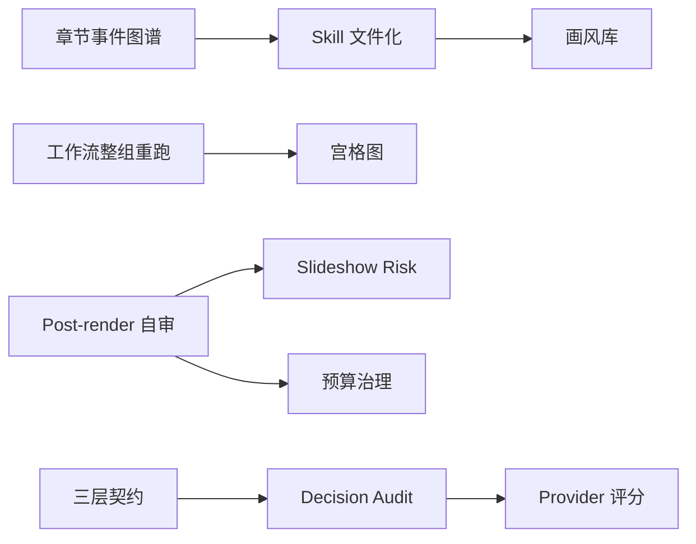

# ai-comic-studio 借鉴落地 Roadmap 总览

> 本 roadmap 将五个参考项目中可直接借鉴的 20 个点，转化为 ai-comic-studio 可执行的代码实施计划。
>
> 参考项目：Huobao Drama、LocalMiniDrama、MoneyPrinterTurbo、OpenMontage、Toonflow。

## 目标

ai-comic-studio 当前已经具备较强的工程化基础：

- 资产世系四层：`master → variant → state → usage`
- `ProductionRun` 批语义：并发、暂停、续跑、失败隔离
- `ModelRuntime` 能力边界：TEXT / IMAGE / SPEECH / VIDEO
- Alembic 有序迁移
- 3D Director Stage
- 就绪门、审核、发布、回收站

本 roadmap 的目标不是推翻现有架构，而是在以下三个方向补强：

1. **用户体感**：减少重跑成本、提升连续性、增强画布操作反馈。
2. **工程成熟度**：补齐渲染后自检、预算、审计、项目可移植能力。
3. **代码质量**：沉淀契约测试、动态 provider 注册、prompt 文件化。

## Milestone 总览

| Milestone | 优先级 | 主题 | 借鉴来源 | 主要价值 |
|---|---|---|---|---|
| M1 | P0 | 基础生产闭环补强 | Toonflow / OpenMontage / LocalMiniDrama | 解决长文本衰减、渲染后裸奔、局部重跑体验差 |
| M2 | P1 | 体验与工程运营 | Toonflow / Huobao / LocalMiniDrama / OpenMontage | prompt 热更新、工程导入导出、三层契约、动态漫风险评分 |
| M3 | P2 | 一致性与扩展性 | Huobao / LocalMiniDrama / Toonflow / OpenMontage | 宫格图、尾帧衔接、画风库、契约测试、adapter 自动注册 |
| M4 | P3 | 可选增强 | OpenMontage / MoneyPrinterTurbo / LocalMiniDrama | 成本治理、provider 评分、CLI、对象存储缓存 |

## 20 条借鉴项矩阵

| # | 项目 | 借鉴点 | Milestone | 难度 | 价值 |
|---|---|---|---|---|---|
| 1 | Toonflow | 章节事件图谱 | M1 | 中 | 长篇连载上下文保真 |
| 2 | OpenMontage | Post-render 自审门 | M1 | 中 | 渲染后质量保障 |
| 3 | LocalMiniDrama | 工作流整组重跑 | M1 | 中 | 审核返工体验提升 |
| 4 | Toonflow / Huobao | Skill 文件化 + 热加载 | M2 | 低-中 | prompt 不改代码不重启 |
| 5 | Toonflow | 三层 Agent 契约 | M2 | 中 | service 边界清晰化 |
| 6 | LocalMiniDrama | 工程 ZIP 导入导出 | M2 | 中 | 项目可移植与备份 |
| 7 | OpenMontage | Slideshow Risk 评分 | M2 | 中 | 动态漫运动质量门 |
| 8 | Huobao | 宫格图流程 | M3 | 中 | 降本 + 视觉一致性 |
| 9 | LocalMiniDrama | 尾帧衔接 | M3 | 低 | 镜头连续性 |
| 10 | Toonflow | 画风库目录化 | M3 | 低 | 风格管理标准化 |
| 11 | OpenMontage | Decision Audit Trail | M3 | 低 | provider 决策可审计 |
| 12 | OpenMontage | 契约测试 | M3 | 低 | CI 无 key 可跑 |
| 13 | Huobao | Adapter 自动注册 | M3 | 低 | provider 扩展效率 |
| 14 | OpenMontage | 预算治理 | M4 | 中 | 防成本失控 |
| 15 | OpenMontage | Provider 7 维评分 | M4 | 低-中 | 多 provider 后自动择优 |
| 16 | MoneyPrinterTurbo | CLI 形态 | M4 | 低 | 无头批处理与 CI |
| 17 | LocalMiniDrama | 图片代理缓存 | M4 | 中 | 上云后 URL 稳定性 |
| 18 | MoneyPrinterTurbo | 编码器自动回退 | M4 | 低 | 渲染跨平台稳定性 |
| 19 | OpenMontage | Human/Quality Gate 组合 | M2/M3 | 中 | 审核质量体系闭环 |
| 20 | Toonflow | 题材/画风方法论沉淀 | M3 | 低 | 内容生产方法论产品化 |

## 实施依赖

## 迁移编号约定

当前最新迁移为：

- `services/api/alembic/versions/20260713_14_production_canvas.py`

后续建议从以下编号开始：

- `20260714_15_chapter_events.py`
- `20260714_16_render_review.py`
- `20260714_17_run_scope.py`

## 通用验收策略

每个功能落地必须满足：

1. 有 Alembic migration，且 `upgrade()` / `downgrade()` 可逆。
2. 有后端单元测试或服务测试。
3. 前端字段兼容旧数据，不能阻断现有工作区加载。
4. 新增 UI 必须以可选能力形式出现，避免强制改变现有流程。
5. 关键结果要能被持久化和回溯。

## 建议推进方式

优先顺序：

1. **先做 M1.1 章节事件图谱**：它影响剧本导入、后续 prompt、故事线索，是最上游能力。
2. **再做 M1.2 Post-render 自审**：它不会影响生产流程，但能补齐交付质量闭环。
3. **再做 M1.3 工作流整组重跑**：它直接改善用户返工体验。
4. M1 稳定后再进入 M2，避免同时引入过多 schema 变化。
