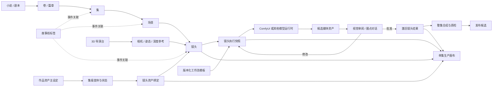

# 镜头领域模型与模块连接契约

状态：产品能力基线，待实现前确认
记录日期：2026-07-14
范围：`ai-comic-studio` 单集生产流程

本文用于在继续开发前固定“镜头”的含义、所有权和跨模块连接方式。它不是页面设计稿，也不表示文中目标能力已经完成。

## 1. 核心结论

**镜头（Shot）是一集时间线中的最小导演与生产单元。**

镜头负责表达“这一小段时间里要讲什么、怎么拍、使用哪些已确认资产、当前采用哪个结果”。镜头不是一张图片、一个视频文件、一个 ComfyUI 工作流、一次生成任务，也不是画布节点本身。

作品结构固定为：

```text
作品
  -> 卷 / 篇章（稳定排序）
    -> 集
      -> 场景
        -> 镜头
```

故事线不改变上述层级，只作为跨集、跨场景、跨镜头的标签关系，用于追踪伏笔、回收、角色成长和冲突。

## 2. 术语边界

| 概念 | 定义 | 与镜头的关系 |
|---|---|---|
| 剧情节拍 | 剧本中的叙事动作或信息变化 | 一个节拍可拆成一个或多个镜头 |
| 场景 | 同一时空段落与连续性上下文 | 包含有序的镜头，但在画布上只作为分组框 |
| 镜头 | 时间线中的原子导演/生产单元 | 拥有稳定 ID、顺序、意图、输入绑定和激活结果 |
| 分镜画面 / Panel | 镜头的静态视觉结果 | 一个镜头可有多个候选和历史版本，只激活一个 |
| 视频片段 / Clip | 镜头的动态视觉结果 | 一个镜头可有多个版本，只激活一个 |
| 对白 | 镜头时间范围内的台词、旁白或声音事件 | 一个镜头可包含零到多条，并分别生成音频 |
| 资产 | 角色、造型、状态、场景、道具等可复用设定 | 镜头只绑定资产版本或状态，不复制主设定 |
| 工作流 | 把镜头输入编译成媒体输出的执行模板 | 可被镜头执行引用，但不属于镜头领域真相 |
| 生产任务 | 某次生成、重试、取消或批处理的运行记录 | 以镜头为目标，生命周期独立于镜头 |
| 画布节点 | 镜头及其依赖关系的 UI 投影 | 可以移动、折叠和聚焦，但不能替代领域数据 |

### 一个镜头是否可以有多张画面

可以，但必须区分用途：

- 候选图、历史版本、修复分支：属于同一镜头的结果版本。
- 首帧、尾帧、深度图、姿态图、遮罩：属于生成输入或中间产物。
- 连续发生的不同构图、不同机位或明确剪切：应拆成同层级的多个镜头。
- 同一机位内的运镜和表演变化：通常保留为一个镜头，由视频提示和关键帧描述。

判断标准不是“生成了几张图”，而是时间线上是否发生了一次新的剪切或导演意图切换。

## 3. 镜头的五层结构

镜头应被理解为五层信息的组合，而不是一个不断追加字段的大对象。

### 3.1 稳定身份与排序

- `shot_id`
- 所属 `scene_id`
- 场景内顺序 `position`
- 预计时长
- 是否启用、废弃或被替换

镜头 ID 在重生成画面、替换工作流、修改提示词、重新审核时保持不变。只有真正拆镜、合镜或删除镜头才改变镜头结构。

### 3.2 创作与导演意图

- 本镜头承担的剧情节拍和信息目标
- 景别、构图、机位、镜头运动
- 角色动作、表情、视线和表演强度
- 场面调度、光线和氛围要求
- 对白、旁白、音效提示
- 图片与视频提示词的 AI 草案及用户确认版本

提示词是从结构化意图生成的执行材料，不应成为唯一的创作真相。

### 3.3 已解析输入

- 角色主设定 -> 集级变体 -> 当前状态
- 场景、道具、服装和其他资产版本
- 角色在本镜头中的表演状态
- 上一镜头激活尾帧或连续性摘要
- 3D 导演台输出的相机、姿态、深度或构图参考
- 用户上传的参考图和明确约束

这些输入必须通过稳定 ID 和版本引用。媒体 URL 只用于展示，不能作为权威引用。

### 3.4 输出与激活指针

- 静态分镜候选、版本和一个 `active_panel_asset_id`
- 对白音频结果
- 视频候选、版本和一个 `active_video_asset_id`
- 可选的首帧、尾帧和其他派生产物

生成成功只会新增候选结果。只有用户批准或明确的自动批准策略才能移动激活指针。

### 3.5 生产、审核与溯源

- 使用的工作流模板版本和输入映射版本
- 生产任务、提供方调用、进度、重试和错误
- 圈点、对话修改指令和修复分支
- 候选审核、批准、拒绝和回滚
- 输入资产、提示词、模型、种子和输出之间的 lineage

这层通过关联记录连接镜头，不应把完整任务历史或 ComfyUI JSON 塞进 `Shot`。

## 4. 模块连接总图



## 5. 各模块对镜头的读写契约

| 模块 | 读取镜头 | 写入镜头或关联记录 | 不允许做的事 |
|---|---|---|---|
| 小说/剧本 | 场景、节拍、对白、角色出场 | 创建镜头草案、对白和导演意图 | 直接生成并激活媒体资产 |
| 卷/篇章 | 集的稳定顺序 | 不直接改镜头 | 用故事线替代层级排序 |
| 故事线 | 镜头的叙事事件 | 添加事件标签、伏笔/回收关系 | 改变镜头父子层级 |
| 资产库 | 镜头使用情况 | 提供主设定、集级变体、状态和版本 | 把镜头生产结果当成主设定覆盖 |
| AI 资产助手 | 剧本需求和已有设定 | 通过对话提出变体/状态草案，确认后保存 | 要求用户手工填写底层提示词才能创建变体 |
| 3D 导演台 | 场景、角色和镜头意图 | 保存相机、构图、姿态、深度等参考 | 直接成为最终画面或绕过审核激活结果 |
| 生产画布 | 聚合全部镜头及依赖状态 | 调整 UI 布局；发起领域命令 | 把 React Flow 节点/边保存为业务真相 |
| ComfyUI | 已冻结的镜头执行快照 | 返回进度、日志和输出文件 | 修改镜头排序、资产主设定或审核结论 |
| 视觉审阅 | 镜头当前画面、候选和 lineage | 圈点、对话、创建修复分支、批准/拒绝 | 未批准就替换激活画面 |
| 音频 | 对白和角色音色 | 生成每条对白的音频资产 | 把音频任务状态混入画面状态 |
| 视频 | 激活分镜、尾帧、相机和视频意图 | 生成镜头视频候选 | 用视频生成结果改写镜头创作意图 |
| 整集合成 | 各镜头激活视频/音频和顺序 | 生成整集渲染及质检快照 | 反向覆盖单镜头资产版本 |

## 6. 资产与镜头的连接规则

资产链固定为：

```text
作品主设定
  -> 集级变体（年龄、造型、服装、伤势等）
    -> 状态（表情、情绪、脏污、伤势阶段、持有物等）
      -> 镜头使用记录
```

规则：

1. 资产库保存可复用的主设定、继承关系和经确认的变体/状态。
2. 镜头通过 usage/binding 记录引用具体版本，不能复制一份失去来源的描述。
3. 同一角色在一个镜头中只能有一个生效造型链，但可叠加多个互不冲突的状态。
4. AI 根据剧本自动提出集级变体、状态和镜头绑定；用户主要通过对话和图片审阅确认，不要求手动创建底层数据。
5. 已被镜头使用的版本不能静默变化。修改后应产生新版本，并标记受影响镜头需要重新确认或重生成。
6. 资产库只展示“被哪些集/场景/镜头使用”，不在资产库内承担镜头生产流程。

## 7. 生产画布中的镜头布局

### 7.1 已确认的 UI 方向

单集生产画布采用 **ComfyUI 风格的无限节点画布 UI**，但承载的是 AI 漫剧领域节点，不要求底层使用 ComfyUI 执行。

需要复用的交互概念包括：

- 无限平移、缩放、小地图和视口定位。
- 节点、类型化输入/输出端口和清晰连接线。
- 框选、多选、拖动、折叠、分组和自动布局。
- 节点搜索、右键菜单、复制和删除允许删除的节点。
- 上下游追踪、连线高亮和错误定位。
- 节点运行、排队、失败、候选就绪和批准状态。
- 右侧参数检查器及底部任务队列。
- 暗色与奶白色画布主题。
- 布局持久化、撤销和恢复。

画布中的节点是产品概念，例如：

```text
角色/场景/道具资产
  -> 镜头资产输入
  -> 3D 导演
  -> 分镜渲染
  -> 视觉审阅
  -> 视频渲染

镜头对白
  -> TTS
  -> 音频结果
```

不应直接把 `CheckpointLoader`、`KSampler` 等底层模型节点暴露在单集生产画布中。

### 7.2 领域约束

单集生产画布遵守以下规则：

- 所有镜头是同层级节点，按场景和时间顺序排列。
- 场景是可折叠分组，不是镜头的流程节点。
- 镜头之间的顺序边由领域数据生成，不允许用户随意重连成新的时间线。
- 用户可以连接有明确类型的生产端口，例如资产到镜头、3D 导演到渲染、分镜到视频、对白到 TTS。
- 每次有效连线必须转换成经过校验的领域命令并保存为真实 binding/usage，不能只存在于前端画布 JSON。
- 不兼容端口、跨项目资产和会形成非法依赖环的连线必须被拒绝。
- 公共资产通过真实的镜头 usage 扇出连接，不显示虚假的“AI 已自动绑定”。
- 选中镜头后展开本镜头局部链：输入资产 -> 分镜 -> 对白/视频 -> 审核。
- 高级 ComfyUI 底层节点图属于某个渲染节点的内部工作流，不进入单集主画布。
- 圈点修改属于某个分镜版本的子工作流，结果批准后只把新资产和状态返回主画布。
- 画布位置、缩放、折叠和主题仅是 UI 状态，不改变镜头业务数据。

## 8. ComfyUI 画布 UI 与执行引擎的边界

这里必须区分两个概念：

| 概念 | 产品定位 | 是否为核心 |
|---|---|---|
| ComfyUI 风格画布 UI | 单集生产的主要交互方式 | 是 |
| ComfyUI 执行引擎 | 某个分镜/视频渲染节点可选择的提供方 | 否，可选 |

生产画布必须在完全不启动 ComfyUI 服务时仍可工作，并能够调用 GPT Image、Qwen TTS 和其他已配置模型。真实 ComfyUI 编辑器只在用户编辑“自定义渲染工作流”时打开，不作为生产画布一级页面。

建议的渲染节点配置为：

```text
分镜渲染节点
  - 执行器：GPT Image / ComfyUI / 其他图片模型
  - 输入：3D 预览、姿态、深度、角色参考、场景参考、提示词
  - 输出：候选分镜资产

TTS 节点
  - 执行器：Qwen TTS / 其他语音模型
  - 输入：对白、角色音色、情绪和语速
  - 输出：对白音频资产
```

### 8.1 使用 ComfyUI 执行时

正确执行链为：

```text
选择镜头
  -> 解析镜头当前创作意图
  -> 冻结本次资产与连续性输入版本
  -> 选择明确版本的工作流模板和输入映射
  -> 编译为 ComfyUI prompt JSON
  -> 提交并跟踪任务
  -> 导入输出为候选资产
  -> 审阅
  -> 批准后激活到镜头
```

必须满足：

- 项目级绑定决定“默认可用哪个工作流”，本次执行记录决定“实际用了哪个精确版本”。
- 每次运行保存不可变输入快照，后续资产或提示词变化不能污染历史结果。
- ComfyUI 输出先注册为项目资产，并记录 provider prompt ID、输出节点和索引，再关联镜头。
- 任务进度映射到生产项，不能直接用 iframe 内部状态冒充项目状态。
- 用户可以进入真实 ComfyUI 高级编辑器，但保存回项目时必须经过工作流导入、校验、版本化和绑定。

## 9. 镜头状态不是一个总状态

镜头需要多个正交状态，不能用一个 `status` 表示全部流程：

| 状态维度 | 示例 |
|---|---|
| 结构状态 | draft / confirmed / omitted |
| 输入就绪 | missing / stale / ready |
| 分镜生产 | pending / queued / running / candidate_ready / failed |
| 分镜审核 | draft / changes_requested / approved |
| 对白音频 | pending / partial / ready / failed |
| 视频生产 | pending / queued / running / candidate_ready / failed |
| 视频审核 | draft / changes_requested / approved |
| 连续性 | unknown / warning / accepted |

UI 可以汇总为一个徽标，但后端必须保留各维度事实，避免“画面成功”被误认为“整个镜头已完成”。

## 10. 当前实现与目标之间的差距

当前代码已经具备：

- `Episode -> Scene -> Shot -> DialogueLine` 基础层级。
- `StorylineEvent` 可关联到集、场景或镜头。
- `AssetVariantUsage` 可把变体/状态关联到镜头。
- `ShotCamera` 与场景级导演台数据入口。
- 镜头激活分镜、激活视频、上一镜头尾帧字段。
- 生产批次、生产项、工作流绑定、视觉审阅和候选资产基础模型。
- 单集生产画布的聚合、布局和状态展示。

当前主要缺口：

1. `Shot.character_state`、图片/视频提示词仍是宽松字段，没有明确区分结构化意图、AI 草案和确认版本。
2. 缺少一次生成所使用的不可变“镜头执行快照”。
3. 工作流绑定是项目级元数据，尚未记录每次镜头执行采用的精确模板、映射和输入版本。
4. ComfyUI 输出尚未自动注册为候选资产，也未回传生产项和镜头状态。
5. 当前画布的公共资产只展示，未形成真实的绑定和影响分析操作。
6. 圈点修改界面尚未创建真实标注、遮罩、修复任务和候选结果。
7. 当前 `active_panel_asset_id` 和 `active_video_asset_id` 是有效的激活指针，但候选版本、审批和回滚链仍需统一。
8. 上一镜头尾帧只是单字段引用，跨镜头连续性规则和失效检测尚未成为明确关系。

## 11. 实现侧对象边界

以下是能力对象，不要求最终数据库表必须使用相同名称：

| 对象 | 责任 |
|---|---|
| `Shot` | 稳定身份、所属场景、顺序和当前激活指针 |
| `ShotSpecRevision` | 版本化的剧情节拍、导演意图、结构化表演和提示词草案/确认值 |
| `ShotAssetBinding` | 镜头对具体资产变体、状态和用途的版本化引用；可复用现有 usage 模型扩展 |
| `ShotExecutionSnapshot` | 某次运行被冻结的 spec、资产、连续性、工作流和参数快照 |
| `ProductionItem` | 排队、运行、进度、重试、取消和错误 |
| `Asset` / 媒体版本 | 实际输入、候选和激活媒体及 lineage |
| `VisualReviewThread` | 圈点、对话、候选审核和修复分支 |
| `ProductionCanvasLayout` | 纯 UI 布局状态 |

## 12. 不变量

1. 镜头是单集时间线原子，所有镜头在主画布同层。
2. 场景只负责组织和连续性上下文，不变成生成任务。
3. 画布节点和边是领域数据的投影，不是另一套业务数据库。
4. 一个镜头可以有多个候选和版本，但每种最终媒体最多一个激活结果。
5. 候选生成成功不等于审核通过，不得自动覆盖激活结果。
6. 工作流版本、输入版本和输出 lineage 必须可追溯。
7. 主资产的变化不得静默改变已经执行或批准的镜头。
8. 3D 导演台只提供导演参考和条件输入，不要求所有资产先成为完整 3D 角色。
9. ComfyUI 风格画布 UI 不依赖 ComfyUI 服务或本地模型才能运行。
10. ComfyUI 执行引擎不拥有项目、镜头、资产或审核状态。
11. 故事线是标签关系，卷/篇章才负责稳定排序。

## 13. 非目标

- 本文不决定具体使用哪一个 checkpoint、LoRA 或 ControlNet。
- 本文不要求把 ComfyUI 底层模型节点复制进生产画布。
- 本文不要求单集画布使用 ComfyUI 后端或 ComfyUI iframe。
- 本文不把资产库改造成生产工作台。
- 本文不要求用户手动维护底层提示词和工作流节点。
- 本文不在当前阶段实现数据库迁移、API 或页面改造。

## 14. 后续实施顺序

1. 先把本文转成后端 schema 和状态机测试，固定镜头、输入、输出和审批边界。
2. 定义 ComfyUI 风格的领域节点、类型化端口、可编辑边和受保护边。
3. 补齐镜头聚合接口，使画布能看到真实资产绑定、失效输入和独立状态维度。
4. 完成“当前镜头 -> 3D 导演 -> GPT Image -> 候选资产 -> 审阅 -> 激活”的默认闭环。
5. 实现版本化工作流模板、输入映射和 `ShotExecutionSnapshot`，让渲染节点可选用 ComfyUI。
6. 再实现对话式资产变体/状态提议、自动镜头绑定和真实圈点修复。
7. 最后补齐连续性检查、更多 3D 条件输入和高级自定义工作流。

完成第 1 项前，不应继续向 `Shot` 增加临时 JSON 字段或用前端静态状态模拟新能力。
